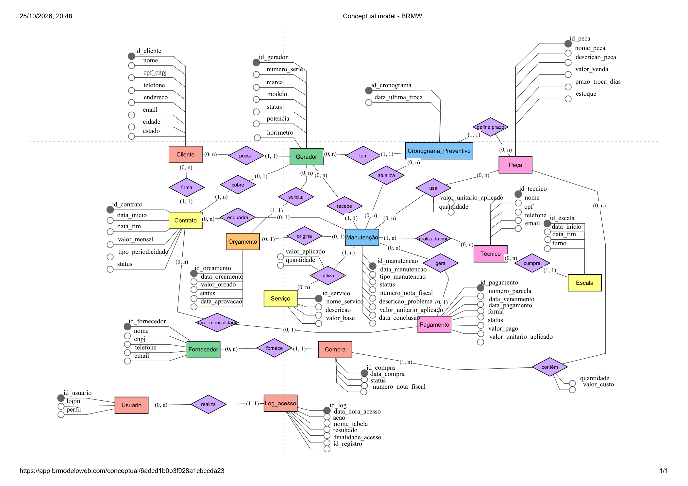

Nomes:

Kauan José da SIlva / RGM: 47346850

Kauê Romaneto Machado / RGM: 47357304

Kaylany Thayna de Oliveira de Paula / RGM: 47039035

Maria Vitória Pereira Alves / RGM: 47230720

## 1. Caracterização da Organização

- S. A DE LIMA - Manutenção preventiva e corretiva de geradores.
- Telefone:+55 11 98373-9556
- E-mail: sandrolima@limasenergia.com.br
- Com fins lucrativos, a empresa conta com 15 funcionários e 96 clientes fixos, somando uma média de 33 manutenções em geradores de energia por mês. 

- Nos dias atuais, a empresa não tem um controle digital para a organização dos seus dados em geral: os dados são mantidos de maneira física, em fichas e papéis. Desde as informações dos atendimentos, até às informações dos clientes. 
Com um banco de dados adequado, essas informações ficarão muito mais seguras, além de estarem organizadas e reservadas somente num lugar, facilitando as buscas, consultas e alterações.

- A organização foi escolhida de acordo com as dificuldades relatadas. A partir disso foram encontradas possibilidades reais de implantar um plano de ação e renovação de fluxos de armazenamento de dados. Além de que o fácil acesso a empresa e contato com o dono contribuiram com a escolha do grupo.

- Endereço da empresa: https://maps.app.goo.gl/XExBHSXrFvbUNv8Y6?g_st=aw
---

## 2. Processos de Negócio
Cadastro de clientes:
- Objetivo: preservar as informações dos clientes da empresa e permitir cadastrar, consultar e buscar o histórico de cada um.
- Quando ocorre: no primeiro atendimento de um cliente novo.
- Dados registrados: nome (ou razão social), CPF/CNPJ, telefone, endereço, e-mail, cidade e estado.
- Regras: todos os campos são obrigatórios; o CPF/CNPJ não pode se repetir; CPF/CNPJ e endereço são armazenados de forma criptografada.
- Resultado: cliente disponível para vincular geradores e consultar o histórico.

Contrato de manutenção (cliente fixos):
- Objetivo: formalizar o atendimento recorrente dos clientes fixos, com cobrança periódica.
- Quando ocorre: quando um cliente fixo passa a ter um acordo de manutenção.
- Dados registrados: cliente, data de início, data de fim (opcional), valor mensal, periodicidade (mensal a anual) e status (ativo, encerrado ou cancelado).
- Regras: o contrato pertence a um cliente e cobre pelo menos um gerador desse mesmo cliente; sem data de fim, o prazo é indeterminado; contrato encerrado exige data de fim.
- Resultado: contrato ativo, que gera as cobranças periódicas (ver 2.3) e enquadra as manutenções dos geradores cobertos.

Cadastro de geradores: 
- Objetivo: controlar os geradores supervisionados pela empresa, mantendo a assertividade nas manutenções.
- Quando ocorre: quando o cliente possui um gerador ainda não registrado.
- Dados registrados: número de série, marca, modelo, status (ativo, em manutenção ou inativo) e potência em kVA.
- Regras: todo gerador pertence a um cliente; o número de série é único (aceita letras e números); um cliente pode ter mais de um gerador, conforme o porte e a necessidade.
- Resultado: equipamento identificado e pronto para receber manutenções. Cada gerador tem um cronograma de inspeção preventiva, orientado pelos prazos de troca ou limpeza de peças como bateria, óleo, filtro de ar e tanque.

Cronograma de manutenção preventiva:
- Objetivo: acompanhar os prazos de troca ou limpeza das peças de cada gerador (bateria, óleo, filtro de ar e tanque).
- Quando ocorre: no cadastro do gerador e a cada troca realizada em uma manutenção.
- Dados registrados: gerador, peça e data da última troca (opcional).
- Regras: um cronograma por peça em cada gerador; o prazo vem da peça (prazo de troca em dias); a manutenção que troca a peça atualiza a data da última troca.
- Resultado: lista de peças vencidas ou a vencer, que orienta as manutenções preventivas.

Manutenção:
- Objetivo: registrar cada atendimento, preventivo ou corretivo.
- Quando ocorre: após a aprovação do orçamento ou direto, em emergência e na preventiva programada.
- Dados registrados: gerador, contrato e orçamento (se houver), data, tipo, status (aberta, em andamento ou concluída), nota fiscal, problema relatado e data de conclusão.
- Regras: vinculada a exatamente um gerador; exige ao menos um técnico e ao menos um serviço; peças são opcionais; status segue aberta → em andamento → concluída; itens só mudam enquanto aberta; o valor não é gravado, é calculado pela soma de (valor unitário × quantidade) dos serviços e peças aplicados.
- Resultado: histórico completo do gerador e do cliente.

Serviço:
- Objetivo: definir o tipo de serviço que será feito, incluindo os valores base.
- Dados registrados: nome, descrição e valor base.
- Regras: não há limite de serviços cadastrados por cliente; um serviço pode ser usado em várias manutenções; o valor base é armazenado de forma criptografada; os serviços seguem as normas NR-10, NR-12, NR-20 e NR-6.
- Resultado: catálogo que alimenta o cálculo do valor de cada manutenção.

Técnico:
- Objetivo: manter um banco de dados com as informações dos técnicos da empresa.
- Dados registrados: nome, CPF, telefone e e-mail.
- Regras: CPF único, digitado somente com números e com exatamente 11 dígitos; o CPF é armazenado de forma criptografada.
- Resultado: técnicos disponíveis para alocação nas manutenções.

Controle de acesso e auditoria:
- Objetivo: controlar quem acessa o sistema e proteger dados pessoaia (LGPD).
- Dados registrados: usuário (login, perfil e status) e log de acesso (data/hora, ação, tabela, resultado e finalidade).
- Regras: perfis administrador, atendimento, técnico e financeiro; usuário técnico se liga a um técnico; usuário é desativado, nunca excluído; o log só recebe inserções, inclusive de logins negados.
- Resultado: acessos rastreáveis e permissões por perfil.

---

## 3. Requisitos do Sistema

### 3.1 Requisitos Funcionais

- O sistema deve cadastrar dados incluindo as informações: nome, CPF/CNPJ, telefone, endereço,e-mail, cidade e estado. Gerador: número de série, marca, modelo, status e potência. Manutenções: data da manutenção, tipo de manutenção, serviço realizado, status e valor. Serviços: nome do serviço,descrição,e valor base. Técnicos: nome, cpf, telefone e email.

- O sistema deve permitir o registro de apenas um gerador por número de série, permitindo a inclusão letras e números.

- O sistema deve permitir cadastrar mais de um gerador por cliente, dependendo do porte e necessidade.

- O sistema deve permitir que exista apenas um técnico por CPF, sendo digitado apenas com números e tendo tamanho exato de 11 dígitos.

- O sistema deve permitir que haja o cadastro de mais de um serviço por cliente, de forma ilimitada.

- O sistema deve cadastrar apenas quando todos os requisitos obrigatórios estiverem preenchidos (estes que foram citados no primeiro requisito funcional).

- O sistema deve permitir que uma manutenção tenha mais de um técnico vinculado, a manutenção precisa ser digitada somente em números, pois trata-se de código único e exclusivo.

- O sistema deve permitir que o usuário cadastre, consulte e busque os históricos dos clientes.

- O sistema deve dar a opção de guardar os RASCUNHOS dos cadastros incompletos, para que o usuario consiga retornar depois para finaliza-lo.

### 3.2 Requisitos Não Funcionais

- Criptografia: todos os dados sensíveis: CPF, endereço, valores; devem ser criptografados, visando a segurança e intgegridade dos usuários. Considerar a criptografia desses itens em todos os atributos que coincidirem com as nomenclaturas citadas.

- Acessibilidade: o sistema deve se adequar às normas impostas pela WCAG 2.1 nível AA, em todas as páginas.

- Tempo de resposta: O sistema deve cadastrar e carregar as respostas em até 5 segundos em todos os dispositivos de acesso.

- Portabilidade e Compatibilidade: O sistema deve estar compatível com os sistemas operacionais populares, desde sua instalação até as suas atualizações.

- Transparência: O programa deve se comportar de maneira acessível, simples e compreensível para todos os usuários.  

## 4. Regras de Negócio

Regras operacionais:
- Toda manutenção deve ter, no mínimo, um serviço vinculado no momento do seu registro; uma manutenção pode envolver mais de um serviço, e o valor final cobrado é a soma dos valores desses serviços.

- Toda manutenção deve ter, no mínimo, um técnico vinculado no momento do seu registro; uma manutenção pode envolver mais de um técnico.

- O gerador necessariamente tem que pertencer a um cliente.

- Dependendo do tipo de manutenção, muda a ordem do pagamento: no caso de uma manutenção corretiva, que impede o funcionamento do gerador, pode haver a troca antes de pagar, mas apenas se o orçamento for confirmado pelo cliente e ele estiver de acordo. Já no caso de uma manutenção preventiva, que não impede o funcionamento do gerador, a manutenção é realizada após o pagamento.

- Os geradores precisam ter um cronograma de inspeção de manutenção preventiva.

- Algumas informações não podem se repetir: são únicas para cada cliente, gerador ou técnico — respectivamente, o CPF/CNPJ, o número de série e o CPF.

Restrições organizacionais:
- Os serviços correspondem e respeitam as normas regulamentadoras NR-10 (elétrica), NR-12 (máquinas), NR-20 (inflamáveis e combustíveis) e NR-6 (EPI), justamente por envolver riscos elétricos, uso de máquinas e manuseio de combustível.

- O sistema não pode ter limite de horário para o registro, devido ao plantão de 24h de atendimento de emergência.

- Peças como bateria, óleo, filtro de ar e tanque têm prazo de troca ou limpeza, o que orienta o cronograma de inspeção preventiva.

---

## 5. Dicionário de Dados Conceitual (Preliminar)
Este modelo representa a empresa S. A DE LIMA, especializada em manutenção preventiva e corretiva de geradores de energia. O sistema tem como finalidade controlar os clientes, os geradores pertencentes a cada cliente, as manutenções realizadas nesses geradores, os técnicos responsáveis e os serviços prestados.

## Ficha técnica
| Item           |   Definição     |                
|----------|-----------|
| SGBD           |   MySQL 8.0, a partir da versão 8.0.16.                   |                 
| Mecanismo de armazenamento           |  	InnoDB, escolhido por suportar chaves estrangeiras, transações e restrições.        |        
| Conjunto de caracteres           | utf8mb4, que cobre todo o Unicode e preserva acentos de nomes, cidades e endereços em português.    |    
| Collation            | utf8mb4_0900_ai_ci. É a padrão do MySQL 8; ignora acentos e diferença de maiúsculas e minúsculas, então a busca por “Sao Paulo” encontra “São Paulo”, e o número de série “abc123” não pode coexistir com “ABC123”, o que reforça a unicidade exigida. O mesmo vale para os demais campos únicos de texto (NM_SERVICO, NM_PECA, DS_LOGIN)                     |    
| Criptografia em repouso            |  Requisito de segurança previsto: criptografia de tablespace do InnoDB (ENCRYPTION='Y'), que exige keyring configurado no servidor.    |    
| Versão do documento            |  5.5                     |    
| Data           |   25/10/2026                    |    
| Notação dos modelos           |  brModelo, no modelo conceitual (DER) e no modelo lógico.                     |    
|  Notação deste dicionário          |  Formal, conforme a tabela de símbolos abaixo.                     |    
| Nomes           | Maiúsculas, sem acentos, no formato PREFIXO_NOME; tabelas no singular. No script SQL, usar exatamente estes nomes.      |    
 
## Notação formal (símbolos usados neste dicionário):
|Símbolo    |Significado  |Exemplo neste dicionário |
|----------|-----------|-----------|
| =         | É composto de          | CLIENTE = @ID_CLIENTE + NM_CLIENTE + …     |
| +         | E (conecta elementos obrigatórios) | NM_CLIENTE + NR_CPF_CNPJ |
| @         | Identificador (chave primária)           |	@ID_CLIENTE  |
|( )        | Elemento opcional          |	(ID_CONTRATO) |
| { }      |  Repetição (iteração); mín{ }máx indica o mínimo e o máximo de ocorrências, e n no máximo significa sem limite fixo (1{ }n = uma ou mais). Convenção de documentação, não é sintaxe SQL  | 1{ID_TECNICO}n	 |
| ( ) | Elemento opcional | (ID_CONTRATO) |
| [ \| ] | Seleção: um dos valores da lista, separados por \| | [ativo \| em_manutencao \| inativo] |

## Convenção de prefixos:
|Tipo | Significado | Exemplo no documento |            
|----------|-----------|-----------|
|ID_        |Identificador      | ID_CLIENTE, ID_GERADOR |
|NM_        | Nome       | NM_CLIENTE, NM_MARCA             |
|DS_        |  Descrição ou dado textual de contato     | DS_ENDERECO, DS_EMAIL, DS_TELEFONE    |
|CD_        |    Código de domínio fixo       | CD_ESTADO                  |
|TP_        |   Tipo ou situação, com lista fechada de valores    | TP_STATUS, TP_MANUTENCAO.     |
|QT_        |   Quantidade contável         |  QT_ESTOQUE, QT_PECA|
|DT_         |  Data                       | DT_MANUTENCAO, DT_INICIO                |
|DH_           |  Data e hora              | DH_ACESSO                 |
|VL_            |  Valor monetário            | 	VL_BASE, VL_MENSAL                |
| MD_     |    Medida com unidade          | 	MD_POTENCIA (kVA), MD_HORIMETRO (h), MD_PRAZO_TROCA_DIAS (dias)      |
| NR_           |   Número de documento ou de série (texto) e número de ordem (inteiro)    |  NR_CPF_CNPJ, NR_CPF, NR_SERIE, NR_NOTA_FISCAL, NR_PARCELA, NR_REGISTRO       |

## Tipos de dado:
|Tipo | Significado | Exemplo no documento |  
|----------|---------- |-----------------------|
|INTEGER    |  Número inteiro, sem casas decimais   | Chaves e quantidades.     |
|BIGINT     |  Inteiro de faixa ampla                     | ID_LOG, que cresce a cada acesso.                |
|DECIMAL    | Número com casas decimais, usado para valores em dinheiro ou medidas   |  Decimal(10,2) guarda até 10 dígitos no total, sendo 2 deles depois da vírgula.    |
|CHAR       | Texto de tamanho fixo      |   Char(2) sempre guarda exatamente 2 caracteres, como a sigla de um estado ("SP"),  CHAR(11) para o CPF. |
|VARCHAR    |Texto de tamanho variável, até um limite máximo  |  Varchar(120) guarda até 120 caracteres, usado em nomes, e-mails, telefones.|
|TEXT       |Texto livre e longo, sem um limite fixo de tamanho   | Usado em descrições mais extensas. |
|DATE / DATETIME   | Guarda uma data / hora          |  Dia, mês e ano / mais horário. |
|ENUM       | Só aceita um valor de uma lista fixa, definida de antemão| Enum(‘ativo’,‘em_manutencao’,‘inativo’) só permite essas três opções, nenhuma outra. |
|PK    |Chave primária | O campo que identifica aquele registro de forma única dentro da tabela; não pode existir dois registros com o mesmo valor nesse campo.|
|FK    | Chave estrangeira  |  Um campo que “empresta” o ID de outra tabela, para ligar as duas. É assim que um gerador fica sabendo a qual cliente ele pertence.|

## 5.1 Modelo conceitual
| Entidade |  Relaciona-se com | Cardinalidade |
|----------|---------- |-----------------------|
|Cliente    | Gerador  | 	1:N — um cliente pode ter zero ou vários geradores (0,n); cada gerador pertence a exatamente um cliente.      |
| Cliente    | Contrato     |  1:N — um cliente pode firmar zero ou vários contratos (0,n); cada contrato é firmado por exatamente um cliente.      |
| Contrato           |  Gerador    |  1:N — um contrato cobre pelo menos um gerador, e pode cobrir vários; um gerador é coberto por zero ou um contrato.               |
|  Contrato          |  Manutenção      | 1:N — um contrato pode enquadrar zero ou várias manutenções; cada manutenção é enquadrada em zero ou um contrato.                |
| Contrato           |  Pagamento       | 1:N — um contrato pode gerar zero ou várias mensalidades; cada pagamento é gerado por zero ou um contrato.    |
| Gerador      | Manutenção      | 1:N — um gerador pode ter zero ou várias manutenções; cada manutenção é feita em exatamente um gerador.   |
|  Gerador      |  Orçamento     |  1:N — um gerador pode ter zero ou vários orçamentos; cada orçamento é solicitado para exatamente um gerador.    |
|  Gerador      |  Cronograma preventivo    |  1:N — um gerador pode ter zero ou vários cronogramas; cada cronograma pertence a exatamente um gerador.               |
| Peça   | Cronograma preventivo    |  1:N — uma peça pode definir o prazo de zero ou vários cronogramas; cada cronograma tem o prazo definido por exatamente uma peça.               |
| Orçamento   |  Manutenção     | 1:1 — um orçamento pode originar zero ou uma manutenção; uma manutenção pode ser originada por zero ou um orçamento.                |
| Manutenção      |  Cronograma preventivo     |  N:N — uma manutenção pode atualizar zero ou vários cronogramas; um cronograma pode ser atualizado por zero ou várias manutenções.               |
| Manutenção    |  Peça    |  N:N — uma manutenção pode usar zero ou várias peças; uma peça pode ser usada em zero ou várias manutenções. Atributos da relação: valor_unitario_aplicado e quantidade.   |
| Manutenção    |   Técnico    | N:N — uma manutenção precisa de pelo menos um técnico, e pode ter vários; um técnico pode participar de zero ou várias manutenções.                |
| Manutenção     | Serviço   | N:N — uma manutenção usa pelo menos um serviço, e pode usar vários; um serviço pode ser usado em zero ou várias manutenções. Atributos da relação: valor_aplicado e quantidade |
| Manutenção     | Pagamento       |  1:N — uma manutenção pode gerar zero ou vários pagamentos; cada pagamento é gerado por zero ou uma manutenção.               |
| Técnico    |  Escala                     |  1:N — um técnico pode cumprir zero ou várias escalas; cada escala é cumprida por exatamente um técnico.               |
| Fornecedor       |  Compra       |  1:N — um fornecedor pode fornecer zero ou várias compras; cada compra é feita de exatamente um fornecedor.               |
| Compra      |    Peça    |  N:N — uma compra contém pelo menos uma peça, e pode conter várias; uma peça pode estar em zero ou várias compras. Atributos da relação: quantidade e valor_custo.               |
| Usuário     | Técnico      | 1:1 — um usuário com perfil técnico é vinculado a exatamente um técnico; um técnico pode ter zero ou um usuário.                |
| Usuário     | Log de acesso       |  1:N — um usuário pode ter zero ou vários logs; cada log pertence a zero ou um usuário, pois tentativas de login negadas não identificam o usuário.               |

## 5.2 Fluxo de dados (visão de DFD)
Cliente é cadastrado em CLIENTE e, quando fixo, firma um CONTRATO → seus geradores são registrados em GERADOR, ligados ao cliente e, se houver, ao contrato que os cobre → cada gerador recebe um CRONOGRAMA_PREVENTIVO por peça, com o prazo definido em PECA → quando um gerador precisa de atendimento, solicita-se um ORCAMENTO (valor total estimado, sem itens) → aprovado o orçamento, ele origina uma MANUTENCAO, ligada ao gerador (e ao contrato, quando houver) → a manutenção é associada a um ou mais técnicos (MANUTENCAO_TECNICO), a um ou mais serviços do catálogo (MANUTENCAO_SERVICO) e às peças usadas (MANUTENCAO_PECA), e atualiza o cronograma preventivo (MANUTENCAO_CRONOGRAMA) → o valor da manutenção é calculado pela soma dos serviços e peças aplicados (valor unitário × quantidade), não é gravado em MANUTENCAO e pode diferir do valor orçado → quando a cobrança da manutenção é parcelada, esse valor calculado é dividido entre as parcelas de PAGAMENTO (VL_PREVISTO), de modo que a soma das parcelas bata com o total → a cobrança gera um PAGAMENTO apenas quando o valor calculado da manutenção é maior que zero: na preventiva, todas as parcelas são quitadas antes da execução; na corretiva, a execução pode ocorrer antes do pagamento somente se a manutenção estiver ligada (ID_ORCAMENTO) a um orçamento aprovado, isto é, confirmado pelo cliente; sem esse orçamento, vale a mesma regra da preventiva → os contratos geram cobranças periódicas em PAGAMENTO, calculadas a partir do valor mensal de referência e da periodicidade, com o valor devido de cada parcela gravado em VL_PREVISTO → do lado das compras, o FORNECEDOR fornece COMPRAS, que contêm as peças (COMPRA_PECA) e repõem o estoque em PECA → cada técnico cumpre suas ESCALAS de plantão → cada USUARIO, com seu perfil (e, no perfil técnico, ligado ao seu cadastro em TECNICO), realiza acessos ao sistema → todo acesso é registrado em LOG_ACESSO, inclusive tentativas de login negadas, nas quais o usuário pode não ser identificado.

## Dicionário de dados por entidade
| | | |
|---|---|---|
| • [CLIENTE](#cliente) | • [ESCALA](#escala) | • [MANUTENCAO_PECA](#manutencao_peca) |
| • [GERADOR](#gerador) | • [PECA](#peca) | • [MANUTENCAO_TECNICO](#manutencao_tecnico) |
| • [CONTRATO](#contrato) | • [CRONOGRAMA_PREVENTIVO](#cronograma_preventivo) | • [MANUTENCAO_CRONOGRAMA](#manutencao_cronograma) |
| • [ORCAMENTO](#orcamento) | • [PAGAMENTO](#pagamento) | • [COMPRA_PECA](#compra_peca) |
| • [MANUTENCAO](#manutencao) | • [FORNECEDOR](#fornecedor) | • [USUARIO](#usuario) |
| • [SERVICO](#servico) | • [COMPRA](#compra) | • [LOG_ACESSO](#log_acesso) |
| • [TECNICO](#tecnico) | • [MANUTENCAO_SERVICO](#manutencao_servico) | |

## CLIENTE 
Pessoa física ou jurídica que contrata os serviços e possui geradores cadastrados.
CLIENTE = @ID_CLIENTE + NM_CLIENTE + NR_CPF_CNPJ + DS_TELEFONE + DS_ENDERECO + DS_EMAIL + NM_CIDADE + CD_ESTADO

Leitura: @ID_CLIENTE é o identificador único; os demais campos são obrigatórios e conectados por +.

| Atributo | Atributo no DER |Tipo físico |Chave| Obrigatório | Único  | Padrão  |Valores permitidos |Significado e relevância    |
|----------|----------- |---- |-----------|----|-----------|----|-----------|----|
|ID_CLIENTE   | id_cliente   | INTEGER AUTO_INCREMENT |PK| Sim  | Sim  |  —  | — |  Identificador único do cliente no sistema; gerado automaticamente. |   
|NM_CLIENTE  | 	nome     | VARCHAR(120)   | — | Sim | Não  | —  |  —  | Nome completo (pessoa física) ou razão social (pessoa jurídica). |   
|NR_CPF_CNPJ | cpf_cnpj      | VARCHAR(14)  |—| Sim | Sim | —  | somente dígitos: 11 (CPF) ou 14 (CNPJ)   | Documento de identificação do cliente, gravado sem pontuação; não pode se repetir. Dado pessoal (quando pessoa física), com proteção prevista por criptografia em repouso. |   
|DS_TELEFONE |  telefone  |  VARCHAR(20)    |— | Sim |Não  | —  |  —  | Telefone de contato. |   
|DS_ENDERECO  | endereco   | VARCHAR(200)    | — | Sim | Não  | —  |  —  | Endereço completo (rua, número, bairro). Dado pessoal, com proteção prevista por criptografia em repouso. |    
| DS_EMAIL  | email   |  VARCHAR(120)    |  — | Sim | Não  | —  | contém @ |E-mail de contato.  | 
| NM_CIDADE |cidade    |  VARCHAR(80)   | — | Sim | Não  | —  | —   | Cidade do cliente. |   
| CD_ESTADO |estado | CHAR(2)  |— | Sim | Não  | —  | uma das 27 UFs  |Sigla do estado (ex.: SP). | 

Padrão do documento: NR_CPF_CNPJ é armazenado somente com dígitos (sem pontos, barra ou hífen); a pontuação é aplicada apenas na exibição. A aplicação remove a pontuação e valida os dígitos verificadores, e um CHECK com REGEXP garante 11 ou 14 dígitos numéricos.

Índices: PK ID_CLIENTE (clusterizado); índice único em NR_CPF_CNPJ (garante a unicidade e agiliza a busca por documento).

## GERADOR
Equipamento de geração de energia pertencente a um cliente e supervisionado pela empresa.
GERADOR = @ID_GERADOR + ID_CLIENTE + (ID_CONTRATO) + NR_SERIE + NM_MARCA + NM_MODELO + TP_STATUS + MD_POTENCIA + MD_HORIMETRO

Leitura: @ID_GERADOR é o identificador único; chaves estrangeiras: ID_CLIENTE referencia CLIENTE; ID_CONTRATO referencia CONTRATO; entre parênteses, opcionais: ID_CONTRATO; os demais campos são obrigatórios e conectados por +.

| Atributo | Atributo no DER |Tipo físico |Chave| Obrigatório | Único  | Padrão  |Valores permitidos |Significado e relevância    |
|----------|----------- |---- |-----------|----|-----------|----|-----------|----|
ID_GERADOR | id_gerador |  INTEGER AUTO_INCREMENT |  PK | Sim | Sim   | —  | —   | Identificador único do gerador. | 
ID_CLIENTE |  — | INTEGER | 	FK → CLIENTE |Sim | Não   | —  | —   | Cliente proprietário; implementa a regra de que todo gerador pertence a um cliente.  | 
ID_CONTRATO| — | INTEGER| FK → CONTRATO | Não | Não  | NULL   |  —  |Contrato que cobre o gerador, quando houver; deve pertencer ao mesmo cliente do gerador.  | 
|NR_SERIE |numero_serie |VARCHAR(30) |— |Sim |Sim | — | letras e números | Número de série de fabricação; um gerador por número de série. |
|NM_MARCA |  marca |  VARCHAR(60) |  — | Sim | Não  | —  | —   | Fabricante. Ex.: Cummins. | 
|NM_MODELO  | modelo | VARCHAR(60) | — | Sim | Não  |  — |  —  | Modelo dentro da marca. | 
| TP_STATUS | status | ENUM | — | Sim | Não | 'ativo' | [ativo \| em_manutencao \| inativo] | Situação atual do gerador. |
|MD_POTENCIA | potencia|  DECIMAL(10,2)  | — | Sim | Não  | —  | > 0   | Potência nominal em kVA. |
|MD_HORIMETRO| horimetro | DECIMAL(10,1)| — | Sim |Não | 0 | ≥ 0 | Horas de operação acumuladas, em horas.|

Índices: PK ID_GERADOR; índice único em NR_SERIE; índices em ID_CLIENTE (geradores de um cliente) e em ID_CONTRATO.

## CONTRATO
Contrato de manutenção firmado com um cliente fixo, com cobrança periódica.
CONTRATO = @ID_CONTRATO + ID_CLIENTE + DT_INICIO + (DT_FIM) + VL_MENSAL + TP_PERIODICIDADE + TP_STATUS

Leitura: @ID_CONTRATO é o identificador único; chaves estrangeiras: ID_CLIENTE referencia CLIENTE; entre parênteses, opcionais: DT_FIM; os demais campos são obrigatórios e conectados por +.

| Atributo | Atributo no DER | Tipo físico | Chave | Obrigatório | Único | Padrão | Valores permitidos | Significado e relevância |
|---|---|---|---|---|---|---|---|---|
| ID_CONTRATO | id_contrato | INTEGER AUTO_INCREMENT | PK | Sim | Sim | — | — | Identificador único do contrato. |
| ID_CLIENTE | — | INTEGER | FK → CLIENTE | Sim | Não | — | — | Cliente contratante. |
| DT_INICIO | data_inicio | DATE | — | Sim | Não | — | — | Início da vigência. |
| DT_FIM | data_fim | DATE | — | Não | Não | NULL | nula ou ≥ DT_INICIO; obrigatória se TP_STATUS = 'encerrado' | Fim da vigência. Nula em contrato ativo sem data final (prazo indeterminado). |
| VL_MENSAL | valor_mensal | DECIMAL(10,2) | — | Sim | Não | — | > 0 | Valor mensal de referência do contrato; a cobrança por período é VL_MENSAL × meses da periodicidade. Dado confidencial do negócio, com proteção prevista por criptografia em repouso. |
| TP_PERIODICIDADE | tipo_periodicidade | ENUM | — | Sim | Não | — | [mensal \| bimestral \| trimestral \| semestral \| anual] | Periodicidade da cobrança do contrato (define quantos meses cada cobrança abrange). |
| TP_STATUS | status | ENUM | — | Sim | Não | 'ativo' | [ativo \| encerrado \| cancelado] | Situação do contrato. |

Índices: PK ID_CONTRATO; índice em ID_CLIENTE; índice em DT_FIM (contratos a vencer).

## ORCAMENTO
Proposta de valor para um gerador; quando aprovada, origina uma manutenção. É uma estimativa do valor total: não registra serviços nem peças previstos, e o valor final da manutenção é calculado pelos itens efetivamente aplicados, podendo diferir de VL_ORCADO.

ORCAMENTO = @ID_ORCAMENTO + ID_GERADOR + DT_ORCAMENTO + VL_ORCADO + TP_STATUS + (DT_APROVACAO)

Leitura: @ID_ORCAMENTO é o identificador único; chaves estrangeiras: ID_GERADOR referencia GERADOR; entre parênteses, opcionais: DT_APROVACAO; os demais campos são obrigatórios e conectados por +.

| Atributo | Atributo no DER | Tipo físico | Chave | Obrigatório | Único | Padrão | Valores permitidos | Significado e relevância |
|---|---|---|---|---|---|---|---|---|
| ID_ORCAMENTO | id_orcamento | INTEGER AUTO_INCREMENT | PK | Sim | Sim | — | — | Identificador único do orçamento. |
| ID_GERADOR | — | INTEGER | FK → GERADOR | Sim | Não | — | — | Gerador para o qual o orçamento foi solicitado. |
| DT_ORCAMENTO | data_orcamento | DATE | — | Sim | Não | CURRENT_DATE | — | Data de emissão. |
| VL_ORCADO | valor_orcado | DECIMAL(10,2) | — | Sim | Não | — | ≥ 0 | Valor total estimado, sem detalhamento de itens. Dado confidencial do negócio, com proteção prevista por criptografia em repouso . |
| TP_STATUS | status | ENUM | — | Sim | Não | 'pendente' | [pendente \| aprovado \| recusado] | Situação do orçamento. |
| DT_APROVACAO | data_aprovacao | DATE | — | Não | Não | NULL | ≥ DT_ORCAMENTO; preenchida se e somente se TP_STATUS = 'aprovado' | Data da aprovação; nula em orçamento pendente ou recusado. |

Índices: PK ID_ORCAMENTO; índice em ID_GERADOR.

## SERVICO
Catálogo de tipos de serviço que podem ser prestados em uma manutenção.
SERVICO = @ID_SERVICO + NM_SERVICO + (DS_DESCRICAO) + VL_BASE

Leitura: @ID_SERVICO é o identificador único; entre parênteses, opcionais: DS_DESCRICAO; os demais campos são obrigatórios e conectados por +.

| Atributo | Atributo no DER | Tipo físico | Chave | Obrigatório | Único | Padrão | Valores permitidos | Significado e relevância |
|---|---|---|---|---|---|---|---|---|
| ID_SERVICO | id_servico | INTEGER AUTO_INCREMENT | PK | Sim | Sim | — | — | Identificador único do serviço. |
| NM_SERVICO | nome_servico | VARCHAR(120) | — | Sim | Sim | — | — | Nome do serviço. Ex.: Troca de óleo. |
| DS_DESCRICAO | descricao | TEXT | — | Não | Não | NULL | — | O que o serviço inclui. |
| VL_BASE | valor_base | DECIMAL(10,2) | — | Sim | Não | — | ≥ 0 | Valor de referência antes de ajustes por manutenção. Dado confidencial do negócio, com proteção prevista por criptografia em repouso. |

Índices: PK ID_SERVICO; índice único em NM_SERVICO.

## MANUTENCAO
Atendimento preventivo ou corretivo realizado em um gerador.
MANUTENCAO = @ID_MANUTENCAO + ID_GERADOR + (ID_CONTRATO) + (ID_ORCAMENTO) + DT_MANUTENCAO + TP_MANUTENCAO + TP_STATUS + (NR_NOTA_FISCAL) + (DS_PROBLEMA) + (DT_CONCLUSAO)

Leitura: @ID_MANUTENCAO é o identificador único; chaves estrangeiras: ID_GERADOR referencia GERADOR; ID_CONTRATO referencia CONTRATO; ID_ORCAMENTO referencia ORCAMENTO; entre parênteses, opcionais: ID_CONTRATO, ID_ORCAMENTO, NR_NOTA_FISCAL, DS_PROBLEMA, DT_CONCLUSAO; os demais campos são obrigatórios e conectados por +.

| Atributo | Atributo no DER | Tipo físico | Chave | Obrigatório | Único | Padrão | Valores permitidos | Significado e relevância |
|---|---|---|---|---|---|---|---|---|
| ID_MANUTENCAO | id_manutencao | INTEGER AUTO_INCREMENT | PK | Sim | Sim | — | somente números | Código único e exclusivo da manutenção. |
| ID_GERADOR | — | INTEGER | FK → GERADOR | Sim | Não | — | — | Gerador atendido; toda manutenção pertence a exatamente um gerador. |
| ID_CONTRATO | — | INTEGER | FK → CONTRATO | Não | Não | NULL | — | Contrato em que a manutenção se enquadra. |
| ID_ORCAMENTO | — | INTEGER | FK → ORCAMENTO | Não | Sim | NULL | — | Orçamento que originou a manutenção (relação 0,1 : 0,1). |
| DT_MANUTENCAO | data_manutencao | DATE | — | Sim | Não | — | — | Data do atendimento. |
| TP_MANUTENCAO | tipo_manutencao | ENUM | — | Sim | Não | — | [preventiva \| corretiva] | Motivo do atendimento. |
| TP_STATUS | status | ENUM | — | Sim | Não | 'aberta' | [aberta \| em_andamento \| concluida] | Situação do atendimento. Transições permitidas: aberta → em_andamento e em_andamento → concluida; sem reabertura nem cancelamento. Itens e valor só mudam enquanto aberta. |
| NR_NOTA_FISCAL | numero_nota_fiscal | VARCHAR(20) | — | Não | Não | NULL | — | Nota fiscal de serviço emitida. |
| DS_PROBLEMA | descricao_problema | TEXT | — | Não | Não | NULL | — | Problema relatado na solicitação. |
| DT_CONCLUSAO | data_conclusao | DATE | — | Não | Não | NULL | ≥ DT_MANUTENCAO; preenchida se e somente se TP_STATUS = 'concluida' | Data de encerramento; preenchida na passagem para concluída. |

Índices: PK ID_MANUTENCAO; índice único em ID_ORCAMENTO; índices em ID_GERADOR (histórico do gerador), ID_CONTRATO e DT_MANUTENCAO (relatórios por período).

## TECNICO
Profissional responsável por executar as manutenções.
TECNICO = @ID_TECNICO + NM_TECNICO + NR_CPF + DS_TELEFONE + DS_EMAIL

Leitura: @ID_TECNICO é o identificador único; os demais campos são obrigatórios e conectados por +.

| Atributo | Atributo no DER | Tipo físico | Chave | Obrigatório | Único | Padrão | Valores permitidos | Significado e relevância |
|---|---|---|---|---|---|---|---|---|
| ID_TECNICO | id_tecnico | INTEGER AUTO_INCREMENT | PK | Sim | Sim | — | — | Identificador único do técnico. |
| NM_TECNICO | nome | VARCHAR(120) | — | Sim | Não | — | — | Nome completo. |
| NR_CPF | cpf | CHAR(11) | — | Sim | Sim | — | somente números, 11 dígitos | CPF; um técnico por CPF. Dado pessoal, com proteção prevista por criptografia em repouso . |
| DS_TELEFONE | telefone | VARCHAR(20) | — | Sim | Não | — | — | Telefone de contato. |
| DS_EMAIL | email | VARCHAR(120) | — | Sim | Não | — | contém @ | E-mail de contato. |

Índices: PK ID_TECNICO; índice único em NR_CPF.

## ESCALA
Período e turno de trabalho cumprido por um técnico (plantão 24 h).
ESCALA = @ID_ESCALA + ID_TECNICO + DT_INICIO + DT_FIM + TP_TURNO

Leitura: @ID_ESCALA é o identificador único; chaves estrangeiras: ID_TECNICO referencia TECNICO; os demais campos são obrigatórios e conectados por +.

| Atributo | Atributo no DER | Tipo físico | Chave | Obrigatório | Único | Padrão | Valores permitidos | Significado e relevância |
|---|---|---|---|---|---|---|---|---|
| ID_ESCALA | id_escala | INTEGER AUTO_INCREMENT | PK | Sim | Sim | — | — | Identificador único da escala. |
| ID_TECNICO | — | INTEGER | FK → TECNICO | Sim | Não | — | — | Técnico escalado. |
| DT_INICIO | data_inicio | DATE | — | Sim | Não | — | — | Início do período. |
| DT_FIM | data_fim | DATE | — | Sim | Não | — | ≥ DT_INICIO | Fim do período. |
| TP_TURNO | turno | ENUM | — | Sim | Não | — | [manha \| tarde \| noite \| integral] | Turno de trabalho. |

Índices: PK ID_ESCALA; índice em ID_TECNICO; índice em DT_INICIO.

## PECA
Peça de reposição (bateria, óleo, filtro de ar, tanque etc.) mantida em estoque e usada nas manutenções.

PECA = @ID_PECA + NM_PECA + (DS_PECA) + VL_VENDA + MD_PRAZO_TROCA_DIAS + QT_ESTOQUE

Leitura: @ID_PECA é o identificador único; entre parênteses, opcionais: DS_PECA; os demais campos são obrigatórios e conectados por +

| Atributo | Atributo no DER | Tipo físico | Chave | Obrigatório | Único | Padrão | Valores permitidos | Significado e relevância |
|---|---|---|---|---|---|---|---|---|
| ID_PECA | id_peca | INTEGER AUTO_INCREMENT | PK | Sim | Sim | — | — | Identificador único da peça. |
| NM_PECA | nome_peca | VARCHAR(120) | — | Sim | Sim | — | — | Nome da peça. |
| DS_PECA | descricao_peca | TEXT | — | Não | Não | NULL | — | Descrição da peça. |
| VL_VENDA | valor_venda | DECIMAL(10,2) | — | Sim | Não | — | ≥ 0 | Preço de venda. Dado confidencial do negócio, com proteção prevista por criptografia em repouso  |
| MD_PRAZO_TROCA_DIAS | prazo_troca_dias | INTEGER | — | Sim | Não | — | > 0 | Prazo de troca ou limpeza, em dias; orienta o cronograma preventivo. |
| QT_ESTOQUE | estoque | INTEGER | — | Sim | Não | 0 | ≥ 0 | Quantidade em estoque; atualizada somente por transação  |

Índices: PK ID_PECA; índice único em NM_PECA.

## CRONOGRAMA_PREVENTIVO
Controle de troca preventiva de uma peça em um gerador; sustenta a regra de inspeção preventiva, pela qual cada gerador deve ter ao menos um cronograma, garantida pela aplicação no cadastro do gerador .

CRONOGRAMA_PREVENTIVO = @ID_CRONOGRAMA + ID_GERADOR + ID_PECA + (DT_ULTIMA_TROCA)

Leitura: @ID_CRONOGRAMA é o identificador único; chaves estrangeiras: ID_GERADOR referencia GERADOR; ID_PECA referencia PECA; entre parênteses, opcionais: DT_ULTIMA_TROCA; os demais campos são obrigatórios e conectados por +.

| Atributo | Atributo no DER | Tipo físico | Chave | Obrigatório | Único | Padrão | Valores permitidos | Significado e relevância |
|---|---|---|---|---|---|---|---|---|
| ID_CRONOGRAMA | id_cronograma | INTEGER AUTO_INCREMENT | PK | Sim | Sim | — | — | Identificador único do cronograma. |
| ID_GERADOR | — | INTEGER | FK → GERADOR | Sim | Não | — | — | Gerador acompanhado. |
| ID_PECA | — | INTEGER | FK → PECA | Sim | Não | — | — | Peça cujo prazo define o cronograma. |
| DT_ULTIMA_TROCA | data_ultima_troca | DATE | — | Não | Não | NULL | — | Data da última troca da peça neste gerador. |

Índices: PK ID_CRONOGRAMA; índice único composto (ID_GERADOR, ID_PECA): um cronograma por peça em cada gerador; índice em ID_PECA.

## PAGAMENTO
Parcela de pagamento de uma manutenção ou mensalidade de contrato.

PAGAMENTO = @ID_PAGAMENTO + [ID_MANUTENCAO | ID_CONTRATO] + NR_PARCELA + DT_VENCIMENTO + VL_PREVISTO + (DT_PAGAMENTO) + (TP_FORMA_PAGAMENTO) + TP_STATUS + (VL_PAGO)

Leitura: @ID_PAGAMENTO é o identificador único; chaves estrangeiras: ID_MANUTENCAO referencia MANUTENCAO; ID_CONTRATO referencia CONTRATO; entre colchetes, exatamente uma das duas origens: ID_MANUTENCAO ou ID_CONTRATO; entre parênteses, opcionais: DT_PAGAMENTO, TP_FORMA_PAGAMENTO, VL_PAGO; os demais campos são obrigatórios e conectados por +.

| Atributo | Atributo no DER | Tipo físico | Chave | Obrigatório | Único | Padrão | Valores permitidos | Significado e relevância |
|---|---|---|---|---|---|---|---|---|
| ID_PAGAMENTO | id_pagamento | INTEGER AUTO_INCREMENT | PK | Sim | Sim | — | — | Identificador único do pagamento. |
| ID_MANUTENCAO | — | INTEGER | FK → MANUTENCAO | Não | Não | NULL | — | Manutenção que gerou a cobrança; ver ID_CONTRATO (a parcela tem exatamente uma origem). |
| ID_CONTRATO | — | INTEGER | FK → CONTRATO | Não | Não | NULL | — | Contrato que gerou a mensalidade; exatamente um entre ID_MANUTENCAO e ID_CONTRATO é preenchido. |
| NR_PARCELA | numero_parcela | INTEGER | — | Sim | Sim, por origem | 1 | ≥ 1 | Número da parcela dentro da manutenção ou do contrato; não se repete na mesma origem. |
| DT_VENCIMENTO | data_vencimento | DATE | — | Sim | Não | — | — | Vencimento. |
| VL_PREVISTO | valor_previsto | DECIMAL(10,2) | — | Sim | Não | — | > 0 | Valor devido na parcela, gravado ao gerá-la: em parcela de contrato, VL_MENSAL × meses da periodicidade; em parcela de manutenção, a fração do valor calculado da manutenção (a soma de VL_PREVISTO das parcelas não canceladas é igual ao valor calculado). Permite comparar o devido com VL_PAGO e dá valor às parcelas pendentes. Dado confidencial do negócio, com proteção prevista por criptografia em repouso. |
| DT_PAGAMENTO | data_pagamento | DATE | — | Não | Não | NULL | preenchida se e somente se TP_STATUS = 'pago' | Data do pagamento efetivo. |
| TP_FORMA_PAGAMENTO | forma | ENUM | — | Não | Não | NULL | [dinheiro \| pix \| boleto \| cartao \| transferencia] | Forma de pagamento; preenchida somente quando TP_STATUS = 'pago'. |
| TP_STATUS | status | ENUM | — | Sim | Não | 'pendente' | [pendente \| pago \| atrasado \| cancelado] | Situação da parcela; define quais campos de pagamento são exigidos. Parcela cancelada por recálculo permanece no histórico; não é apagada. Transições permitidas e correção de parcela paga. |
| VL_PAGO | valor_pago | DECIMAL(10,2) | — | Não | Não | NULL | ≥ 0 | Valor efetivamente pago; pode diferir de VL_PREVISTO (juros ou desconto). Dado confidencial do negócio, com proteção prevista por criptografia em repouso. |

Quitação e exclusão: a parcela é quitada de uma só vez (sem pagamento parcial nem saldo restante) e PAGAMENTO nunca é excluído: erros são tratados por cancelamento e nova parcela ou, em parcela já paga, por correção do administrador registrada em LOG_ACESSO.

Índices: PK ID_PAGAMENTO; índice único composto (ID_MANUTENCAO, NR_PARCELA) e índice único composto (ID_CONTRATO, NR_PARCELA): como o MySQL aceita vários NULL em índice único, a linha cuja origem é nula não colide, e cada origem tem suas parcelas numeradas sem repetição; índice em DT_VENCIMENTO (contas a receber).

## FORNECEDOR
Empresa que fornece peças.

FORNECEDOR = @ID_FORNECEDOR + NM_FORNECEDOR + NR_CNPJ + DS_TELEFONE + DS_EMAIL

Leitura: @ID_FORNECEDOR é o identificador único; os demais campos são obrigatórios e conectados por +.

| Atributo | Atributo no DER | Tipo físico | Chave | Obrigatório | Único | Padrão | Valores permitidos | Significado e relevância |
|---|---|---|---|---|---|---|---|---|
| ID_FORNECEDOR | id_fornecedor | INTEGER AUTO_INCREMENT | PK | Sim | Sim | — | — | Identificador único do fornecedor. |
| NM_FORNECEDOR | nome | VARCHAR(120) | — | Sim | Não | — | — | Razão social ou nome. |
| NR_CNPJ | cnpj | CHAR(14) | — | Sim | Sim | — | somente dígitos, 14 | CNPJ do fornecedor, gravado sem pontuação. |
| DS_TELEFONE | telefone | VARCHAR(20) | — | Sim | Não | — | — | Telefone de contato. |
| DS_EMAIL | email | VARCHAR(120) | — | Sim | Não | — | contém @ | E-mail de contato. |

Índices: PK ID_FORNECEDOR; índice único em NR_CNPJ.

## COMPRA
Compra de peças junto a um fornecedor.

COMPRA = @ID_COMPRA + ID_FORNECEDOR + DT_COMPRA + TP_STATUS + (NR_NOTA_FISCAL)

Leitura: @ID_COMPRA é o identificador único; chaves estrangeiras: ID_FORNECEDOR referencia FORNECEDOR; entre parênteses, opcionais: NR_NOTA_FISCAL; os demais campos são obrigatórios e conectados por +.

| Atributo | Atributo no DER | Tipo físico | Chave | Obrigatório | Único | Padrão | Valores permitidos | Significado e relevância |
|---|---|---|---|---|---|---|---|---|
| ID_COMPRA | id_compra | INTEGER AUTO_INCREMENT | PK | Sim | Sim | — | — | Identificador único da compra. |
| ID_FORNECEDOR | — | INTEGER | FK → FORNECEDOR | Sim | Não | — | — | Fornecedor da compra. |
| DT_COMPRA | data_compra | DATE | — | Sim | Não | — | — | Data da compra. |
| TP_STATUS | status | ENUM | — | Sim | Não | 'pedida' | [pedida \| recebida \| cancelada] | Situação da compra. Transições permitidas: pedida → recebida e pedida → cancelada; recebida e cancelada são finais. |
| NR_NOTA_FISCAL | numero_nota_fiscal | VARCHAR(20) | — | Não | Não | NULL | — | Nota fiscal do fornecedor. |

Itens da compra: os itens (COMPRA_PECA) só podem ser alterados enquanto TP_STATUS = 'pedida'; compra recebida ou cancelada tem os itens bloqueados.

Índices: PK ID_COMPRA; índices em ID_FORNECEDOR e DT_COMPRA.

## MANUTENCAO_SERVICO
MANUTENCAO_SERVICO = @ID_MANUTENCAO + @ID_SERVICO + VL_UNITARIO_APLICADO + QT_SERVICO

Leitura: os campos marcados com @ (ID_MANUTENCAO, ID_SERVICO) formam juntos a chave primária composta e são, cada um, chave estrangeira; os demais campos são obrigatórios e conectados por +.

| Atributo | Atributo no DER | Tipo físico | Chave | Obrigatório | Único | Padrão | Valores permitidos | Significado e relevância |
|---|---|---|---|---|---|---|---|---|
| ID_MANUTENCAO | — | INTEGER | PK, FK → MANUTENCAO | Sim | — | — | — | Manutenção envolvida. |
| ID_SERVICO | — | INTEGER | PK, FK → SERVICO | Sim | — | — | — | Serviço realizado; permite mais de um por manutenção. |
| VL_UNITARIO_APLICADO | valor_unitario_aplicado | DECIMAL(10,2) | — | Sim | Não | — | ≥ 0 | Valor unitário do serviço nesta manutenção (não é o total da linha); o total da linha é VL_UNITARIO_APLICADO × QT_SERVICO, e o valor da manutenção soma esses totais. Dado confidencial do negócio, com proteção prevista por criptografia em repouso . |
| QT_SERVICO | quantidade | INTEGER | — | Sim | Não | 1 | > 0 | Quantidade executada; multiplica o valor unitário aplicado. |

Bloqueio: peças só podem ser incluídas, alteradas ou removidas enquanto a manutenção está aberta; fora disso, somente por autorização do administrador, registrada em LOG_ACESSO.

Índices: Chave primária composta (ID_MANUTENCAO, ID_SERVICO); índice de chave estrangeira em ID_SERVICO.

## MANUTENCAO_PECA
MANUTENCAO_PECA = @ID_MANUTENCAO + @ID_PECA + VL_UNITARIO_APLICADO + QT_PECA

Leitura: os campos marcados com @ (ID_MANUTENCAO, ID_PECA) formam juntos a chave primária composta e são, cada um, chave estrangeira; os demais campos são obrigatórios e conectados por +.

| Atributo | Atributo no DER | Tipo físico | Chave | Obrigatório | Único | Padrão | Valores permitidos | Significado e relevância |
|---|---|---|---|---|---|---|---|---|
| ID_MANUTENCAO | — | INTEGER | PK, FK → MANUTENCAO | Sim | — | — | — | Manutenção envolvida. |
| ID_PECA | — | INTEGER | PK, FK → PECA | Sim | — | — | — | Peça utilizada. |
| VL_UNITARIO_APLICADO | valor_unitario_aplicado | DECIMAL(10,2) | — | Sim | Não | — | ≥ 0 | Valor unitário da peça nesta manutenção. Dado confidencial do negócio, com proteção prevista por criptografia em repouso. |
| QT_PECA | quantidade | INTEGER | — | Sim | Não | 1 | > 0 | Quantidade usada. |

Bloqueio: peças só podem ser incluídos, alterados ou removidos enquanto a manutenção está aberta; fora disso, somente por autorização do administrador, registrada em LOG_ACESSO.

Índices: Chave primária composta (ID_MANUTENCAO, ID_PECA); índice de chave estrangeira em ID_PECA.

## MANUTENCAO_TECNICO
MANUTENCAO_TECNICO = @ID_MANUTENCAO + @ID_TECNICO

Leitura: os campos marcados com @ (ID_MANUTENCAO, ID_TECNICO) formam juntos a chave primária composta e são, cada um, chave estrangeira; os demais campos são obrigatórios e conectados por +.

| Atributo | Atributo no DER | Tipo físico | Chave | Obrigatório | Único | Padrão | Valores permitidos | Significado e relevância |
|---|---|---|---|---|---|---|---|---|
| ID_MANUTENCAO | — | INTEGER | PK, FK → MANUTENCAO | Sim | — | — | — | Manutenção envolvida. |
| ID_TECNICO | — | INTEGER | PK, FK → TECNICO | Sim | — | — | — | Técnico envolvido; permite mais de um por manutenção. |

Índices: Chave primária composta (ID_MANUTENCAO, ID_TECNICO); índice de chave estrangeira em ID_TECNICO.

## MANUTENCAO_CRONOGRAMA
MANUTENCAO_CRONOGRAMA = @ID_MANUTENCAO + @ID_CRONOGRAMA

Leitura: os campos marcados com @ (ID_MANUTENCAO, ID_CRONOGRAMA) formam juntos a chave primária composta e são, cada um, chave estrangeira; os demais campos são obrigatórios e conectados por +.

| Atributo | Atributo no DER | Tipo físico | Chave | Obrigatório | Único | Padrão | Valores permitidos | Significado e relevância |
|---|---|---|---|---|---|---|---|---|
| ID_MANUTENCAO | — | INTEGER | PK, FK → MANUTENCAO | Sim | — | — | — | Manutenção que atualizou o cronograma. |
| ID_CRONOGRAMA | — | INTEGER | PK, FK → CRONOGRAMA_PREVENTIVO | Sim | — | — | — | Cronograma atualizado. |

Índices: Chave primária composta (ID_MANUTENCAO, ID_CRONOGRAMA); índice de chave estrangeira em ID_CRONOGRAMA.

## COMPRA_PECA
COMPRA_PECA = @ID_COMPRA + @ID_PECA + QT_PECA + VL_CUSTO

Leitura: os campos marcados com @ (ID_COMPRA, ID_PECA) formam juntos a chave primária composta e são, cada um, chave estrangeira; os demais campos são obrigatórios e conectados por +.

| Atributo | Atributo no DER | Tipo físico | Chave | Obrigatório | Único | Padrão | Valores permitidos | Significado e relevância |
|---|---|---|---|---|---|---|---|---|
| ID_COMPRA | — | INTEGER | PK, FK → COMPRA | Sim | — | — | — | Compra. |
| ID_PECA | — | INTEGER | PK, FK → PECA | Sim | — | — | — | Peça comprada. |
| QT_PECA | quantidade | INTEGER | — | Sim | Não | — | > 0 | Quantidade comprada. |
| VL_CUSTO | valor_custo | DECIMAL(10,2) | — | Sim | Não | — | ≥ 0 | Custo unitário pago ao fornecedor. Dado confidencial do negócio, com proteção prevista por criptografia em repouso. |

Bloqueio: os itens só podem ser incluídos, alterados ou removidos enquanto a compra está 'pedida'.

Índices: Chave primária composta (ID_COMPRA, ID_PECA); índice de chave estrangeira em ID_PECA.

## USUARIO
Conta de acesso ao sistema; define o perfil de acesso, é a origem dos registros de LOG_ACESSO e, no perfil técnico, identifica qual técnico usa a conta.

USUARIO = @ID_USUARIO + (ID_TECNICO) + DS_LOGIN + TP_PERFIL + TP_STATUS

Leitura: @ID_USUARIO é o identificador único; chaves estrangeiras: ID_TECNICO referencia TECNICO; entre parênteses, opcionais: ID_TECNICO (obrigatório quando TP_PERFIL = tecnico e nulo nos demais perfis); os demais campos são obrigatórios e conectados por +.

| Atributo | Atributo no DER | Tipo físico | Chave | Obrigatório | Único | Padrão | Valores permitidos | Significado e relevância |
|---|---|---|---|---|---|---|---|---|
| ID_USUARIO | id_usuario | INTEGER AUTO_INCREMENT | PK | Sim | Sim | — | — | Identificador único do usuário. |
| ID_TECNICO | — | INTEGER | FK → TECNICO | Não | Sim | NULL | obrigatório se TP_PERFIL = 'tecnico'; nulo nos demais perfis | Técnico que usa a conta; permite aplicar as permissões "próprio cadastro" e "manutenções em que está alocado". Um técnico tem no máximo uma conta. |
| DS_LOGIN | login | VARCHAR(60) | — | Sim | Sim | — | — | Nome de acesso; não pode se repetir. |
| TP_PERFIL | perfil | ENUM | — | Sim | Não | — | [administrador \| atendimento \| tecnico \| financeiro] | Perfil que define as operações permitidas. |
| TP_STATUS | status | ENUM | — | Sim | Não | 'ativo' | [ativo \| inativo] | Situação da conta. O usuário não é excluído: é desativado ('inativo'), o que impede o acesso e preserva o histórico de LOG_ACESSO. |

Índices: PK ID_USUARIO; índice único em DS_LOGIN; índice único em ID_TECNICO (um técnico por conta; vários NULL permitidos).

## LOG_ACESSO
LOG_ACESSO = @ID_LOG + (ID_USUARIO) + (DS_LOGIN_INFORMADO) + DH_ACESSO + TP_ACAO + (NM_TABELA) + (NR_REGISTRO) + (DS_IP_ORIGEM) + TP_RESULTADO + (DS_FINALIDADE)

Leitura: @ID_LOG é o identificador único; chaves estrangeiras: ID_USUARIO referencia USUARIO; entre parênteses, opcionais: ID_USUARIO (nulo somente em login negado sem usuário identificado), DS_LOGIN_INFORMADO (preenchido somente quando ID_USUARIO é nulo), DS_IP_ORIGEM (nulo quando o IP não puder ser identificado), NM_TABELA, NR_REGISTRO, DS_FINALIDADE; os demais campos são obrigatórios e conectados por +.

| Atributo | Atributo no DER | Tipo físico | Chave | Obrigatório | Único | Padrão | Valores permitidos | Significado e relevância |
|---|---|---|---|---|---|---|---|---|
| ID_LOG | id_log | BIGINT AUTO_INCREMENT | PK | Sim | Sim | — | — | Identificador único do registro. |
| ID_USUARIO | — | INTEGER | FK → USUARIO | Não | Não | NULL | nulo somente se TP_ACAO = 'login' e TP_RESULTADO = 'negado' (e então DS_LOGIN_INFORMADO é preenchido) | Usuário que realizou o acesso (relacionamento realiza); nulo quando a tentativa não identifica um usuário cadastrado. |
| DS_LOGIN_INFORMADO | login_informado | VARCHAR(60) | — | Não | Não | NULL | preenchido se e somente se ID_USUARIO é nulo; até 60 caracteres | Login digitado na tentativa, usado para registrar logins negados de usuário inexistente. Nunca recebe senha nem token; a aplicação limita o tamanho e não grava o campo de senha. |
| DH_ACESSO | data_hora_acesso | DATETIME | — | Sim | Não | CURRENT_TIMESTAMP | — | Data e hora do acesso. |
| TP_ACAO | acao | ENUM | — | Sim | Não | — | [login \| logout \| select \| insert \| update \| delete] | Operação realizada. |
| NM_TABELA | nome_tabela | VARCHAR(64) | — | Não | Não | NULL | — | Tabela consultada ou alterada. |
| NR_REGISTRO | numero_registro | INTEGER | — | Não | Não | NULL | — | Registro afetado (sem FK, pois a tabela de origem varia). |
| DS_IP_ORIGEM | ip_origem | VARCHAR(45) | — | Não | Não | NULL | — | Endereço IP de origem (IPv4 ou IPv6). Nulo quando o sistema não consegue identificá-lo (acesso interno, rotina agendada); nenhum endereço é inventado. |
| TP_RESULTADO | resultado | ENUM | — | Sim | Não | 'sucesso' | [sucesso \| negado] | Resultado da tentativa. |
| DS_FINALIDADE | finalidade_acesso | VARCHAR(150) | — | Não | Não | NULL | — | Finalidade do tratamento, quando há acesso a dado pessoal. Também guarda a justificativa de uma alteração excepcional de itens da manutenção, de uma correção de parcela paga e de cada execução da rotina de retenção. |

Índices: PK ID_LOG; índices em ID_USUARIO e em DH_ACESSO. Nenhum perfil tem UPDATE nem DELETE: o log só recebe INSERT. Apenas a rotina de retenção elimina registros vencidos ou anonimiza o IP.

## LGPD
Tratamento de dados pessoais conforme a Lei nº 13.709/2018. O controlador é a S. A DE LIMA. O modelo não armazena dados pessoais sensíveis (art. 5º, II), mas CPF, CNPJ de pessoa física, endereço, telefone e e-mail são dados pessoais.
| Tabela  | Tabela    | Classificação  | Base legal   |
|---|---|---|---|
| CLIENTE  | 	NM_CLIENTE, NR_CPF_CNPJ, DS_TELEFONE, DS_ENDERECO, DS_EMAIL, NM_CIDADE, CD_ESTADO  |Dado pessoal (pessoa física); NR_CPF_CNPJ e DS_ENDERECO com proteção prevista por criptografia em repouso   | Execução de contrato (art. 7º, V); obrigação legal para emissão fiscal (art. 7º, II)    |
|TECNICO  | NM_TECNICO, NR_CPF, DS_TELEFONE, DS_EMAIL   | Dado pessoal; NR_CPF com proteção prevista por criptografia em repouso  | Execução de contrato (art. 7º, V); obrigação legal (art. 7º, II)   |
| FORNECEDOR | NM_FORNECEDOR, NR_CNPJ, DS_TELEFONE, DS_EMAIL  | 	Dado pessoal somente se pessoa física ou MEI   | Execução de contrato (art. 7º, V)   |
| USUARIO   | DS_LOGIN, ID_TECNICO   | 	Dado pessoal (identifica a pessoa que acessa e, no perfil técnico, a liga ao cadastro do técnico)  | Execução de contrato (art. 7º, V); segurança (art. 46)    |
| LOG_ACESSO | 	ID_USUARIO, DS_LOGIN_INFORMADO, DS_IP_ORIGEM, DH_ACESSO  | Dado pessoal (identifica quem acessou e de onde)  | Obrigação legal e segurança (art. 7º, II; arts. 37 e 46)   |

Finalidade: cadastro e identificação de clientes, técnicos e fornecedores, execução de contratos e manutenções, cobrança e emissão fiscal.

Situação da implementação: a criptografia em repouso, os privilégios por perfil e o registro em LOG_ACESSO são requisitos de segurança deste projeto. A criptografia de tablespace do InnoDB aplica-se à tabela inteira (não a colunas isoladas) e depende de um keyring habilitado no servidor; 

## 6. Modelagem Conceitual (Entidades, Atributos, Relacionamentos)

A modelagem conceitual foi elaborada a partir dos processos de negócio, requisitos funcionais e regras de negócio levantados na empresa S. A DE LIMA. O modelo representa os clientes e seus contratos, os geradores, os orçamentos e as manutenções (com técnicos, serviços e peças), o cronograma de manutenção preventiva, o controle financeiro (pagamentos), o abastecimento de peças (fornecedores e compras), a escala dos técnicos e o controle de acesso ao sistema.

## 6.1 Entidades reconhecidas

Foram identificadas quinze entidades, organizadas em cinco grupos.

## Relacionamento com o cliente

### Cliente:
pessoa física ou jurídica que contrata os serviços da empresa.
Contrato: acordo firmado com um cliente fixo, com cobrança periódica e vigência definida.
Gerador: equipamento de geração de energia de propriedade do cliente e supervisionado pela empresa.

## Atendimento

### Orçamento:
proposta de valor total estimado para um gerador; quando aprovada, origina uma manutenção.

### Manutenção: 
atendimento preventivo ou corretivo realizado em um gerador.

### Serviço: 
catálogo de serviços que podem ser prestados em uma manutenção.

### Técnico: 
profissional que executa as manutenções.

### Escala:
período e turno de plantão cumprido por um técnico.

## Peças e manutenção preventiva

### Peça:
item de reposição (bateria, óleo, filtro de ar, tanque etc.) mantido em estoque.

### Cronograma_Preventivo:
controle da troca preventiva de uma peça em um gerador específico.

## Financeiro e suprimentos

### Pagamento: 
parcela de cobrança, originada de uma manutenção ou da mensalidade de um contrato.

### Fornecedor: 
empresa que fornece peças.

### Compra: 
aquisição de peças junto a um fornecedor.

## Segurança

### Usuário: 
conta de acesso ao sistema, com perfil de permissões.

### Log_acesso:
registro de cada acesso e operação realizada no sistema.

### 6.2 Atributos e classificações

Os atributos foram definidos de acordo com as informações necessárias para identificar e controlar cada entidade.

Cliente

| Atributo | Classificação |
|---|---|
| `id_cliente` | Identificador |
| `nome` | Descritivo |
| `cpf_cnpj` | Identificação / único |
| `telefone` | Contato |
| `endereco` | Localização |
| `email` | Contato |
| `cidade` | Localização |
| `estado` | Localização |

O id_cliente identifica exclusivamente cada cliente. O cpf_cnpj deve ser único e obrigatório. Essas informações já estão definidas no dicionário de dados do projeto.

Contrato

| Atributo | Classificação |
|---|---|
| `id_contrato` | Identificador |
| `data_inicio` | Temporal |
| `data_fim` | Temporal |
| `valor_mensal` | Quantitativo |
| `tipo_periodicidade` | Classificação |
| `status` | Classificação |

A data_fim é opcional, pois um contrato ativo pode ter prazo indeterminado. O tipo_periodicidade define quantos meses cada cobrança abrange (mensal, bimestral, trimestral, semestral ou anual).

Gerador

| Atributo | Classificação |
|---|---|
| `id_gerador` | Identificador |
| `numero_serie` | Identificação / único |
| `marca` | Descritivo |
| `modelo` | Descritivo |
| `status` | Classificação |
| `potencia` | Quantitativo |
| `horimetro` | Quantitativo |

O numero_serie é um identificador único do equipamento. A potencia é medida em kVA e o horimetro registra as horas de operação acumuladas.

Orçamento

| Atributo | Classificação |
|---|---|
| `id_orcamento` | Identificador |
| `data_orcamento` | Temporal |
| `valor_orcado` | Quantitativo |
| `status` | Classificação |
| `data_aprovacao` | Temporal |

O valor_orcado é uma estimativa do valor total, sem detalhar serviços e peças. A data_aprovacao só é preenchida quando o orçamento é aprovado.

Manutenção

| Atributo | Classificação |
|---|---|
| `id_manutencao` | Identificador |
| `data_manutencao` | Temporal |
| `tipo_manutencao` | Classificação |
| `status` | Classificação |
| `numero_nota_fiscal` | Identificação |
| `descricao_problema` | Descritivo |
| `data_conclusao` | Temporal |

A entidade registra o atendimento realizado em um gerador e permite diferenciar manutenções preventivas e corretivas. O valor da manutenção não é armazenado: ele é calculado pela soma dos serviços e peças aplicados.

Serviço

| Atributo | Classificação |
|---|---|
| `id_servico` | Identificador |
| `nome_servico` | Descritivo / único |
| `descricao` | Descritivo |
| `valor_base` | Quantitativo |

Os atributos permitem identificar o serviço, explicar o que será realizado e estabelecer seu valor de referência.

Técnico

| Atributo | Classificação |
|---|---|
| `id_tecnico` | Identificador |
| `nome` | Descritivo |
| `cpf` | Identificação / único |
| `telefone` | Contato |
| `email` | Contato |

O cpf é único para cada técnico, conforme a regra estabelecida para o sistema.

Escala

| Atributo | Classificação |
|---|---|
| `id_escala` | Identificador |
| `data_inicio` | Temporal |
| `data_fim` | Temporal |
| `turno` | Classificação |

O turno pode ser manhã, tarde, noite ou integral, e a data_fim não pode ser anterior à data_inicio.

Peça

| Atributo | Classificação |
|---|---|
| `id_peca` | Identificador |
| `nome_peca` | Descritivo / único |
| `descricao_peca` | Descritivo |
| `valor_venda` | Quantitativo |
| `prazo_troca_dias` | Quantitativo |
| `estoque` | Quantitativo |

O prazo_troca_dias indica a cada quantos dias a peça deve ser trocada ou limpa e orienta o cronograma preventivo.

Cronograma_Preventivo

| Atributo | Classificação |
|---|---|
| `id_cronograma` | Identificador |
| `data_ultima_troca` | Temporal |

Cada gerador tem no máximo um cronograma por peça. A data_ultima_troca é opcional, pois a peça pode ainda não ter sido trocada.

Pagamento

| Atributo | Classificação |
|---|---|
| `id_pagamento` | Identificador |
| `numero_parcela` | Identificação |
| `data_vencimento` | Temporal |
| `valor_previsto` | Quantitativo |
| `data_pagamento` | Temporal |
| `forma` | Classificação |
| `status` | Classificação |
| `valor_pago` | Quantitativo |

O valor_previsto é o valor devido na parcela e o valor_pago é o efetivamente quitado, podendo diferir por juros ou desconto. A data_pagamento, a forma e o valor_pago só são preenchidos quando a parcela é paga.

Fornecedor

| Atributo | Classificação |
|---|---|
| `id_fornecedor` | Identificador |
| `nome` | Descritivo |
| `cnpj` | Identificação / único |
| `telefone` | Contato |
| `email` | Contato |

O cnpj é único para cada fornecedor e é gravado somente com números.

Compra

| Atributo | Classificação |
|---|---|
| `id_compra` | Identificador |
| `data_compra` | Temporal |
| `status` | Classificação |
| `numero_nota_fiscal` | Identificação |

O status da compra pode ser pedida, recebida ou cancelada, e a nota fiscal é opcional.

Usuário

| Atributo | Classificação |
|---|---|
| `id_usuario` | Identificador |
| `login` | Identificação / único |
| `perfil` | Classificação |
| `status` | Classificação |

O perfil pode ser administrador, atendimento, técnico ou financeiro. O usuário não é excluído, e sim desativado, para preservar o histórico.

Log_acesso

| Atributo | Classificação |
|---|---|
| `id_log` | Identificador |
| `data_hora_acesso` | Temporal |
| `acao` | Classificação |
| `nome_tabela` | Descritivo |
| `numero_registro` | Referência |
| `resultado` | Classificação |
| `finalidade_acesso` | Descritivo |
| `login_informado` | Descritivo |
| `ip_origem` | Localização |

O log só recebe inserções. O login_informado é usado quando a tentativa de acesso não identifica um usuário cadastrado, e a finalidade_acesso registra o motivo do acesso a dado pessoal.

Atributos dos relacionamentos

| Relacionamento | Atributos |
|---|---|
| Manutenção utiliza Serviço | `valor_aplicado`, `quantidade` |
| Manutenção usa Peça | `valor_unitario_aplicado`, `quantidade` |
| Compra contém Peça | `quantidade`, `valor_custo` |

Esses atributos pertencem à ligação entre as entidades, e não a uma delas isoladamente.

### 6.3 Relacionamentos pertinentes

Foram identificados vinte relacionamentos entre as entidades.

# Cliente — possui — Gerador

Cardinalidade: 1:N

Um cliente pode possuir zero ou vários geradores, enquanto cada gerador pertence obrigatoriamente a um único cliente.

CLIENTE (0,n) ─── possui ─── (1,1) GERADOR

Essa relação representa a regra de negócio de que todo gerador cadastrado deve estar vinculado a um cliente.

# Cliente — firma — Contrato

Cardinalidade: 1:N

Um cliente pode firmar zero ou vários contratos, enquanto cada contrato é firmado por um único cliente.

CLIENTE (0,n) ─── firma ─── (1,1) CONTRATO

Essa relação permite manter o histórico contratual de cada cliente.

# Contrato — cobre — Gerador

Cardinalidade: 1:N

Um contrato cobre pelo menos um gerador e pode cobrir vários, enquanto um gerador é coberto por zero ou um contrato.

CONTRATO (1,n) ─── cobre ─── (0,1) GERADOR

O contrato que cobre o gerador deve pertencer ao mesmo cliente do gerador.

# Contrato — enquadra — Manutenção

Cardinalidade: 1:N

Um contrato pode enquadrar zero ou várias manutenções, enquanto cada manutenção se enquadra em zero ou um contrato.

CONTRATO (0,n) ─── enquadra ─── (0,1) MANUTENÇÃO

Nem toda manutenção ocorre dentro de um contrato, como as corretivas avulsas.

# Contrato — gera_mensalidade — Pagamento

Cardinalidade: 1:N

Um contrato pode gerar zero ou várias mensalidades, enquanto cada pagamento é gerado por zero ou um contrato.

CONTRATO (0,n) ─── gera_mensalidade ─── (0,1) PAGAMENTO

O lado (0,1) existe porque a parcela pode, em vez disso, ter origem em uma manutenção.

# Gerador — solicita — Orçamento

Cardinalidade: 1:N

Um gerador pode ter zero ou vários orçamentos, enquanto cada orçamento é solicitado para um único gerador.

GERADOR (0,n) ─── solicita ─── (1,1) ORÇAMENTO

Essa relação permite guardar o histórico de propostas feitas para cada equipamento.

# Gerador — recebe — Manutenção

Cardinalidade: 1:N

Um gerador pode receber zero ou várias manutenções durante sua utilização. Cada manutenção, entretanto, deve estar obrigatoriamente relacionada a um único gerador.

GERADOR (0,n) ─── recebe ─── (1,1) MANUTENÇÃO

Essa relação permite manter o histórico de atendimentos realizados em cada equipamento.

# Gerador — tem — Cronograma_Preventivo

Cardinalidade: 1:N

Um gerador pode ter zero ou vários cronogramas, um para cada peça acompanhada, enquanto cada cronograma pertence a um único gerador.

GERADOR (0,n) ─── tem ─── (1,1) CRONOGRAMA_PREVENTIVO

Essa relação representa a regra de que os geradores precisam ter um cronograma de inspeção preventiva.

# Peça — define prazo — Cronograma_Preventivo

Cardinalidade: 1:N

Uma peça pode definir o prazo de zero ou vários cronogramas, enquanto cada cronograma tem o prazo definido por uma única peça.

PEÇA (0,n) ─── define prazo ─── (1,1) CRONOGRAMA_PREVENTIVO

O prazo de troca da peça orienta quando a próxima troca preventiva deve ocorrer.

# Orçamento — origina — Manutenção

Cardinalidade: 1:1

Um orçamento pode originar zero ou uma manutenção, e uma manutenção pode ter sido originada por zero ou um orçamento.

ORÇAMENTO (0,1) ─── origina ─── (0,1) MANUTENÇÃO

Um orçamento recusado não gera manutenção, e uma emergência pode ser atendida sem orçamento prévio.

# Manutenção — atualiza — Cronograma_Preventivo

Cardinalidade: N:N

Uma manutenção pode atualizar zero ou vários cronogramas, e um cronograma pode ser atualizado por zero ou várias manutenções.

MANUTENÇÃO (0,n) ─── atualiza ─── (0,n) CRONOGRAMA_PREVENTIVO

Ao trocar uma peça, a manutenção atualiza a data da última troca no cronograma correspondente.

# Manutenção — usa — Peça

Cardinalidade: N:N

Uma manutenção pode usar zero ou várias peças, e uma peça pode ser usada em zero ou várias manutenções.

MANUTENÇÃO (0,n) ─── usa ─── (0,n) PEÇA

Atributos da relação: valor_unitario_aplicado e quantidade.

# Manutenção — realizada por — Técnico

Cardinalidade: N:N

Uma manutenção pode envolver um ou vários técnicos, enquanto um técnico pode participar de zero ou várias manutenções.

MANUTENÇÃO (1,n) ─── realizada por ─── (0,n) TÉCNICO

A cardinalidade foi definida dessa forma porque o sistema deve permitir que uma mesma manutenção tenha mais de um técnico vinculado.

# Manutenção — utiliza — Serviço

Cardinalidade: N:N

Uma manutenção pode utilizar um ou vários serviços, enquanto um serviço pode ser utilizado em zero ou várias manutenções.

MANUTENÇÃO (1,n) ─── utiliza ─── (0,n) SERVIÇO

Essa relação foi definida porque uma manutenção pode envolver mais de um serviço e o valor final pode ser composto pelos serviços realizados. Atributos da relação: valor_aplicado e quantidade.

# Manutenção — gera — Pagamento

Cardinalidade: 1:N

Uma manutenção pode gerar zero ou várias parcelas de pagamento, enquanto cada pagamento é gerado por zero ou uma manutenção.

MANUTENÇÃO (0,n) ─── gera ─── (0,1) PAGAMENTO

Cada parcela tem exatamente uma origem: uma manutenção ou um contrato.

# Técnico — cumpre — Escala

Cardinalidade: 1:N

Um técnico pode cumprir zero ou várias escalas, enquanto cada escala é cumprida por um único técnico.

TÉCNICO (0,n) ─── cumpre ─── (1,1) ESCALA

Essa relação apoia o plantão de 24 horas da empresa.

# Fornecedor — fornece — Compra

Cardinalidade: 1:N

Um fornecedor pode fornecer zero ou várias compras, enquanto cada compra é feita de um único fornecedor.

FORNECEDOR (0,n) ─── fornece ─── (1,1) COMPRA

Essa relação permite rastrear de quem cada peça foi comprada.

# Compra — contém — Peça

Cardinalidade: N:N

Uma compra contém uma ou várias peças, e uma peça pode estar em zero ou várias compras.

COMPRA (1,n) ─── contém ─── (0,n) PEÇA

Atributos da relação: quantidade e valor_custo. As compras recebidas repõem o estoque das peças.

# Usuário — realiza — Log_acesso

Cardinalidade: 1:N

Um usuário pode realizar zero ou vários acessos, enquanto cada log pertence a zero ou um usuário.

USUÁRIO (0,n) ─── realiza ─── (0,1) LOG_ACESSO

O lado (0,1) existe porque tentativas de login negadas podem não identificar um usuário cadastrado.

# Usuário — vincula-se a — Técnico

Cardinalidade: 1:1

Um usuário com perfil técnico é vinculado a exatamente um técnico, e um técnico pode ter zero ou uma conta de usuário.

USUÁRIO (0,1) ─── vincula-se a ─── (0,1) TÉCNICO

Essa relação permite aplicar a permissão de acesso apenas às manutenções em que o técnico está alocado.
### 6.4 Restrições e políticas organizacionais

O modelo conceitual considera as principais regras de negócio identificadas durante o levantamento da empresa.

Todo gerador deve estar vinculado a um cliente.
Toda manutenção deve estar vinculada a um gerador.
O número de série do gerador deve ser único.
O CPF do técnico deve ser único.
Uma manutenção deve possuir pelo menos um técnico.
Uma manutenção deve possuir pelo menos um serviço.
Uma manutenção pode possuir vários técnicos.
Uma manutenção pode possuir vários serviços.
O sistema deve manter o histórico das manutenções realizadas nos geradores.
O tipo de manutenção pode ser preventiva ou corretiva.
Os geradores devem possuir um cronograma de inspeção preventiva.
O atendimento não deve possuir limitação de horário devido ao plantão de 24 horas da empresa.

---

## 7. Diagrama Entidade-Relacionamento (DER)

---

## 8. Justificativa Técnica
- Entidades: Separamos Cliente, Gerador, Manutenção, Técnico e Serviço porque cada uma tem ciclo de vida próprio — um cliente existe sem gerador, um gerador passa por várias manutenções, um técnico atende várias manutenções, e um serviço é um catálogo reutilizável. Se juntasse manutenção e gerador ficaria duplicando dados a cada manutenção assim também como serviço é uma entidade separada para evitar repetição de dados.

- Atributos: Cada atributo ficou na entidade que ele realmente descreve. Dados que variam a cada evento (data, tipo, status, valor) foram para Manutenção; dados fixos do equipamento (marca, modelo, potência) ficaram em Gerador. Os dados do técnico que não entraram direto em manutenção pra evitar que aja redundância e também possibilitar consulta de histórico de cada técnico.

Cardinalidade:
- Cliente–Gerador (0,n)-(1,1): um cliente pode ter vários geradores, mas cada gerador tem só um dono.
  
- Gerador-Manutenção (0,n)-(1,1): um gerador pode ter várias manutenções, mas cada manutenção é sobre um único gerador.
  
- Manutenção–Técnico (1,n)-(0,n): toda manutenção precisa de pelo menos um técnico, e um técnico pode atender várias manutenções.
  
- Manutenção–Serviço (1,n)-(0,n): toda manutenção precisa de ao menos um serviço definido no momento do registro; um serviço pode estar cadastrado no catálogo sem nunca ter sido utilizado, ou ter sido aplicado em várias manutenções.
  
---

## 9. Uso de Inteligência Artificial
| Item | Registro |
|------|------------------|
| Ferramenta e etapa 1 | Gemini Flash, usada durante a etapa de levantamento dos Requisitos Não Funcionais (RNF) do sistema de controle de geradores e manutenções.|
| *Motivação* | Precisávamos de ajuda para acrescentar mais alguns Requisitos Não Funcionais para compor o dicionário de dados e utilizamos a IA como um ponto de partida. O objetivo foi identificar quais categorias de RNF são mais comuns, como desempenho, segurança e disponibilidade, além de obter exemplos de como esses requisitos poderiam ser descritos. |
| *Prompt(s) utilizados* | "Cite alguns Requisitos Não Funcionais"|
| *Resposta recebida* | A IA explicou que os Requisitos Não Funcionais estão relacionados à forma como o sistema deve funcionar, estabelecendo características, restrições e critérios de qualidade, em vez de descrever funcionalidades específicas. Em seguida, apresentou algumas categorias e exemplos. Entre elas, foram citadas Desempenho e Eficiência, com exemplos relacionados ao tempo de resposta e à capacidade de processamento do sistema, e Segurança, com exemplos como a criptografia de dados sensíveis e a utilização de autenticação de dois fatores (2FA). A resposta também mencionava uma terceira categoria, relacionada à disponibilidade, mas essa parte não chegou a ser analisada completamente	 |
| *Fontes consultadas e verificadas* | Não foram utilizadas fontes externas. As informações vieram do próprio material produzido pelo grupo, com base na visita e na pesquisa de campo realizadas na empresa. |
| *Trechos rejeitados ou corrigidos* | Os exemplos numéricos relacionados ao desempenho, como o tempo de resposta de até 2 segundos e o processamento de 1.000 transações por segundo, foram ajustados. Esses valores eram genéricos e não representavam a realidade da empresa estudada, que possui 96 clientes fixos e uma média de 33 manutenções por mês.	 |
| *Justificativa da escolha final* |Decidimos aproveitar as categorias sugeridas pela IA, principalmente desempenho/eficiência e segurança, pois elas são importantes para o sistema que está sendo desenvolvido. Porém, os exemplos foram adaptados de acordo com a realidade da empresa. Também foram incluídos requisitos relacionados à segurança dos dados e à autenticação. |
| *Reflexão crítica* | O uso da IA ajudou a ter uma ideia inicial de quais Requisitos Não Funcionais poderiam ser utilizados no sistema. Porém, percebemos que nem todos os exemplos apresentados serviam para a realidade da empresa, principalmente os valores relacionados ao desempenho. Por isso, foi necessário analisar as sugestões e fazer as adaptações. Com isso, entendemos que a IA é uma boa ferramenta para ajudar no desenvolvimento do trabalho, mas não devemos aceitar tudo o que ela apresenta sem verificar. É importante usar nosso próprio conhecimento e considerar as necessidades reais da empresa.	|

| Item | Registro |
|------|------------------|
| Ferramenta e etapa 2 |Claude, utilizada como apoio para organizar o dicionário de dados (DER) de acordo com o modelo apresentado. |
| *Motivação* | Organizar as informações do rascunho no formato do exemplo solicitado. |
| *Prompt(s) utilizados* | "Poderia me ajudar a revisar o arquivo".|
| *Resposta recebida* | 	Documento reorganizado com tabelas de atributos, descrição, e regra de negócio associada. |
| *Fontes consultadas e verificadas* | Não foram utilizadas fontes externas. As informações vieram do próprio material produzido pelo grupo, com base na visita e na pesquisa de campo realizadas na empresa.|
| *Trechos rejeitados ou corrigidos* | Decidimos retirar as partes de “Log de acesso” e “Conformidade com a LGPD” que apareciam no exemplo. Essas seções estavam mais relacionadas ao caso apresentado no modelo, que envolvia dados sensíveis de saúde, e não eram necessárias para o projeto da empresa escolhida. |
| *Justificativa da escolha final* | A estrutura do exemplo foi aproveitada porque atendia ao formato solicitado, mas algumas partes foram retiradas para que o documento ficasse adequado ao contexto da empresa e às informações levantadas. |
| *Reflexão crítica* | 	O exemplo ajudou bastante na organização das informações, mas foi necessário analisar o que realmente se aplicava ao projeto. Dessa forma, utilizamos apenas o modelo como referência e fizemos as adaptações necessárias ao próprio trabalho. |

| Item | Registro |
|------|------------------|
| Ferramenta e etapa 3 | Claude, utilizada durante a elaboração da etapa das regras de negócio, para a realização de correções gramaticais do conteúdo.  |
| *Motivação* | Correção do texto contido na etapa 4 (Regras de negócio). |
| *Prompt(s) utilizados* |  [Problema]: O texto pode conter erros. [Condição]: Pode ter qualquer estilo. [Desafio]: Corrigir sem alterar o sentido. [Tarefa]: Corrija gramática, ortografia, pontuação e acentuação, mantendo o estilo original. Retorne apenas o texto corrigido. |
| *Resposta recebida* | Texto corrigido e mantendo concordância e as regras gramáticais. |
| *Fontes consultadas e verificadas* | Não foram utilizadas fontes externas. As informações vieram do próprio material produzido pelo grupo, com base na visita e na pesquisa de campo realizadas na empresa. |
| *Trechos rejeitados ou corrigidos* | Foi decidido inserir a parte "justamente por envolver riscos elétricos, uso de máquinas e manuseio de combustível.", justamente pra existir uma justificativa dessa restrições organizacionais |
| *Justificativa da escolha final* | A IA analisa os detalhes do texto para realizar as correções necessárias |
| *Reflexão crítica* | A correção foi prática e eficaz, porém foi necessário conferir as informações e analisar se era necessário realizar alguma alteração ou adicionar alguma informação. |

| Item | Registro |
|------|------------------|
| Ferramenta e etapa 4 | ChatGPT, utilizado como apoio durante a etapa de Modelagem Conceitual do sistema de controle de geradores e manutenções.|
| *Motivação* |  Tivemos dificuldade para organizar as entidades, seus atributos e principalmente as cardinalidades dos relacionamentos entre Cliente, Gerador, Manutenção, Técnico e Serviço. Utilizamos a IA como apoio para revisar a estrutura que já havia sido definida pelo grupo e verificar se os relacionamentos estavam de acordo com os requisitos e regras de negócio levantados. |
| *Prompt(s) utilizados* | “Com base nos requisitos, regras de negócio e dicionário de dados do projeto, ajude a identificar as entidades, atributos, relacionamentos e cardinalidades da modelagem conceitual.” |
| *Resposta recebida* | A IA organizou as principais entidades do sistema e explicou os relacionamentos entre elas. Foi indicado que Cliente e Gerador possuem uma relação 1:N, Gerador e Manutenção possuem uma relação 1:N, enquanto Manutenção e Técnico e Manutenção e Serviço possuem relações N:N. Também foram apresentadas justificativas para as cardinalidades com base nas regras de negócio.	 |
| *Fontes consultadas e verificadas* |Não foram utilizadas fontes externas. As informações vieram do próprio material produzido pelo grupo, com base na visita e na pesquisa de campo realizadas na empresa.|
| *Trechos rejeitados ou corrigidos* | 	Algumas sugestões da IA foram analisadas e não foram utilizadas diretamente, principalmente sugestões relacionadas à criação de entidades associativas. Como o objetivo dessa etapa era representar o modelo conceitual, mantivemos os relacionamentos N:N entre Manutenção e Técnico e entre Manutenção e Serviço conforme a estrutura adotada pelo grupo. |
| *Justificativa da escolha final* | A IA foi utilizada apenas como apoio para revisar e organizar o modelo. A decisão final sobre as entidades, atributos e cardinalidades foi feita pelo grupo, considerando os requisitos e as regras de negócio da empresa estudada. |
| *Reflexão crítica* | A utilização da IA ajudou principalmente a visualizar possíveis problemas na modelagem e entender melhor as cardinalidades. Porém, percebemos que uma sugestão gerada automaticamente não deve ser aplicada sem análise. Foi necessário comparar as sugestões com as regras de negócio e com o modelo que já havia sido desenvolvido pelo grupo. Dessa forma, a IA serviu como ferramenta de apoio e revisão, e não como responsável pela definição final do modelo.	|
